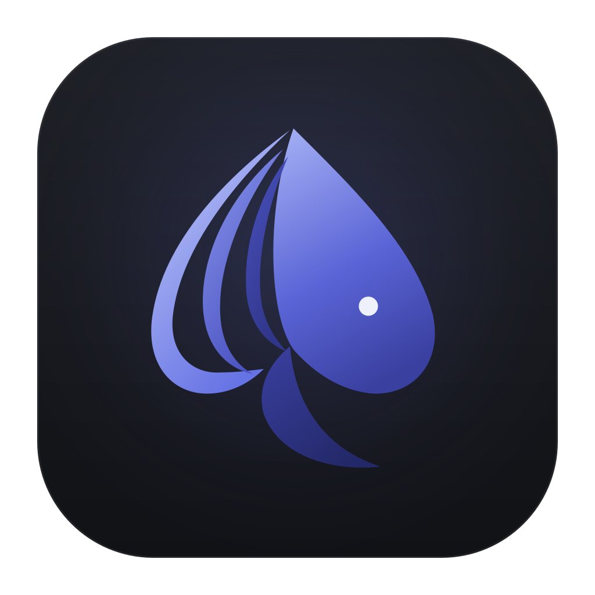
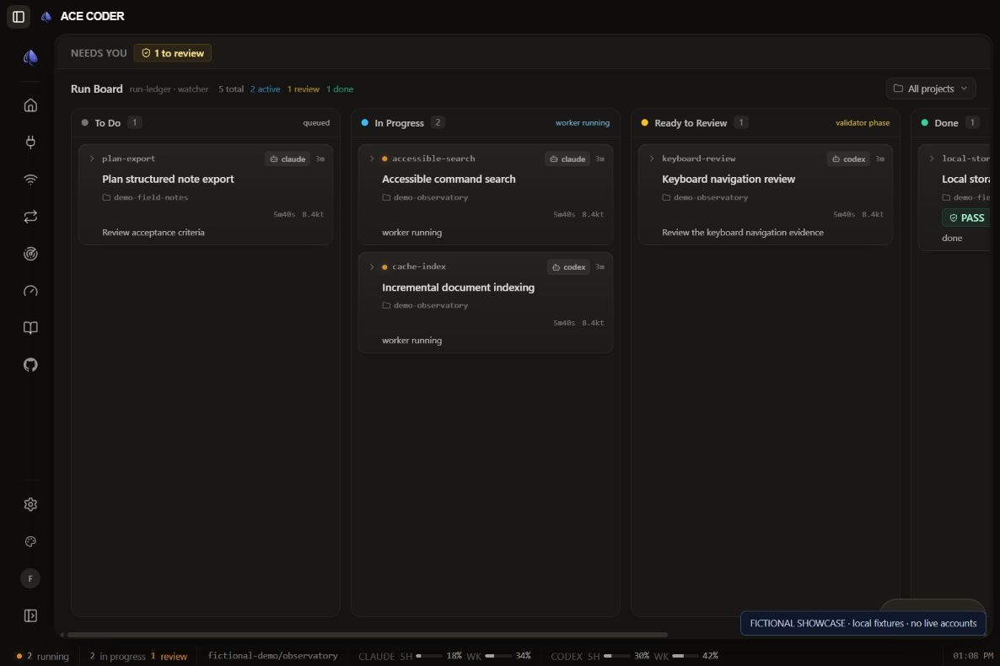
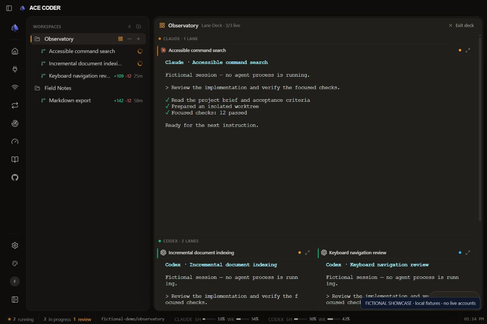
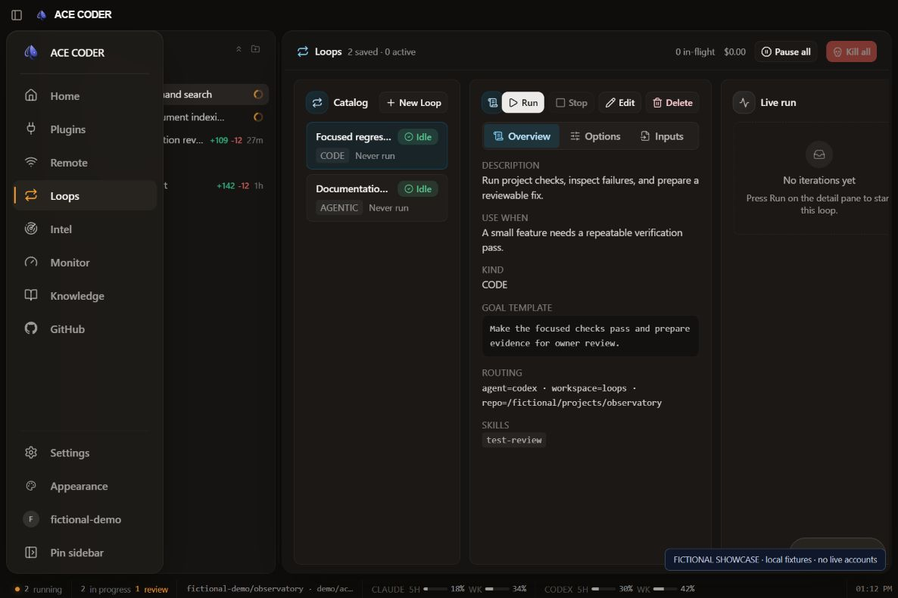
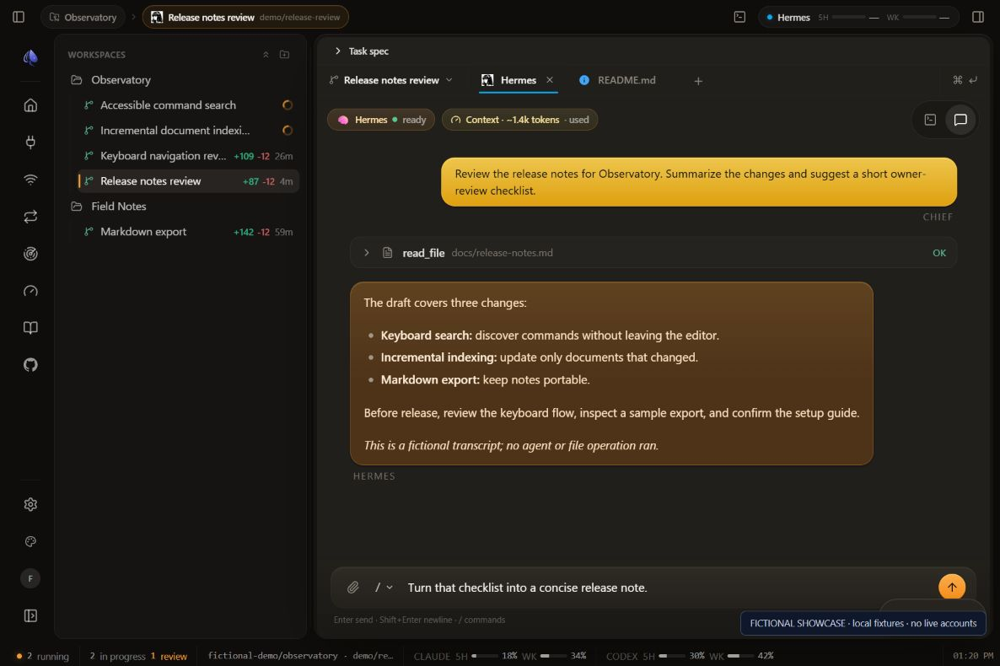

<p align="center">
  
</p>

<h1 align="center">Skysphere ACE CODER</h1>

<p align="center"><strong>The desktop command center for your AI coding team.</strong></p>
<p align="center">Parallel agents · Isolated worktrees · Reviewable workflows · Local project state</p>

Skysphere ACE CODER brings your coding agents, repositories, terminals, and review workflow
into one desktop application. Run agents side by side, give each task its own
branch and worktree, follow progress across a live lane deck, and turn completed
work into changes you can inspect and integrate.

Built by **Skysphere Labs** for developers who want to coordinate an AI coding
team while staying close to the code. Use the agents and provider accounts you
already have; ACE CODER supplies the workspace around them.

**Desktop packaging targets:** macOS and Windows. **Project license:** Apache-2.0.

This repository is a **read-only source release**. You can inspect, build,
modify, and redistribute the code under its license, and develop your own fork.
Pull requests and contributions to this release mirror are not accepted.

## From a task to a reviewed change

1. **Bring a repository.** Open a local project or clone through your GitHub account.
2. **Choose the work.** Start a task, pick an agent, and use a dedicated worktree when the change needs its own branch.
3. **Work in parallel.** Arrange agent panes, open supporting terminals and files, or watch the whole workspace in the lane deck.
4. **Steer as it runs.** Read live output, send follow-up instructions, respond to prompts, and inspect the recorded state.
5. **Review the result.** Read the diff, stage files, commit, and use the GitHub integration workflow for pull requests and checks.
6. **Keep the context.** Tasks, transcripts, run history, and project knowledge give the next session somewhere to start.

## A workspace built for orchestration

| Capability | What it gives you |
| --- | --- |
| **Parallel tasks and worktrees** | Separate branches and working directories for independent changes, with multiple agent panes inside a task. |
| **Live lane deck** | A tiled view of a workspace's agent lanes, branch labels, and working, waiting, approval, completion, and error states. |
| **Orchestrators and workers** | Persistent agent lanes plus scoped run specifications, worker dispatch, validation, and recorded completion evidence. |
| **Run Board** | A shared view of queued, active, review-ready, completed, and blocked work, backed by an append-only run ledger. |
| **Reusable loops** | Saved workflows for build/review cycles, CI hardening, documentation sweeps, and dependency triage, with run history and stop conditions. |
| **Git and GitHub** | File diffs, staging, commits, branch/worktree controls, repository browsing, pull requests, checks, and integration gates. |
| **A complete task workbench** | Real PTY terminals, a Monaco file editor, task-scoped browser tabs, and split panes alongside your agents. |
| **Skills and MCP** | Discover and manage skills, create local skills, and configure catalog or custom MCP servers for compatible providers. |
| **Local knowledge** | Search project knowledge and wiki material, inspect freshness and trust labels, and explore linked pages in a graph. |
| **Operations and usage** | Runtime and service health, agent liveness, local telemetry, and provider usage readings where available. |
| **Remote and mobile views** | Use a browser on a paired device over your LAN or Tailscale, with device enrollment and revocation controls. |
| **Local storage** | SQLite-backed application state, transcript storage, and a rebuildable knowledge index; optional external storage configuration. |

The [full feature tour](docs/FEATURES.md) explains how these pieces fit together,
including provider differences, optional integrations, and current limits.

## Inside the workspace

These captures show the real interface with fictional local demo data. They
illustrate the workflow and layout; the pictured activity is not a live agent
run. The [complete screenshot tour](docs/screenshots/README.md) maps all 18
capability groups to their captures or source and explains what was exercised.

**Coordinate queued, active, and review-ready work from the Run Board.**



**Follow multiple coding lanes in one workspace.**



**Build repeatable workflows with saved loops.**



**Keep the conversation and tool results together in Hermes structured chat.**



## Bring your preferred agents

The provider catalog contains launch profiles for these **24 CLI agents**:

| | | | |
| --- | --- | --- | --- |
| Claude Code | Codex | Cursor | Gemini |
| GitHub Copilot | Amp | OpenCode | Qwen Code |
| Hermes Agent | Goose | Cline | Continue |
| Kiro | Kimi | Droid | Auggie |
| Charm | Rovo Dev | Codebuff | Mistral Vibe |
| Kilocode | Pi | Autohand Code | Forge |

Install and authenticate the CLIs you want to use. A catalog profile means ACE
CODER knows how to discover and launch that CLI; model controls, session resume,
attachments, and usage reporting vary by provider and installed version.

Coding lanes preserve the agent's native terminal interface. Hermes also has a
structured chat surface with an enhanced composer. Its optional embedded desktop
view needs a compatible user-managed Hermes installation.

Provider subscriptions, API access, and model charges are supplied by you and
remain subject to each provider's terms. They are not included with ACE CODER.

## Run from source

You need:

- macOS or Windows, Git, and **Node.js 22.12 or newer**.
- At least one installed, authenticated coding-agent CLI.
- The **GitHub CLI (`gh`)** if you want GitHub account, repository, or pull-request features.
- Native build tools if your platform needs to compile `better-sqlite3` or `node-pty`.

```bash
git clone https://github.com/skysphere-labs/ace-coder-public.git ace-coder
cd ace-coder
npm ci
npm run dev
```

Local startup does not require a Skysphere account, a paid ACE seat, a Cloudflare
account, or a hosted ACE backend. GitHub authentication is optional for local
work and uses your own GitHub account.

Build the application:

```bash
npm run build
```

Create a local package on the corresponding platform:

```bash
npm run package:mac   # macOS DMG
npm run package:win   # Windows NSIS installer
```

The public edition does not use Skysphere's private authentication, Cloudflare
release service, or private automatic updater. This source release does not
promise future updates or signed/notarized installers. Linux desktop packaging
is not currently documented.

## Local state, explicit connections

Projects, task state, transcripts, and the knowledge index are stored on your
machine. **Local storage does not mean offline AI:** your chosen agents may send
prompts, code, attachments, and tool results to their model providers. GitHub,
MCP servers, browser pages, and other integrations make their own network
connections. Choose those services and their permissions to suit your project.

Remote access is optional and uses device pairing. A paired device can control
the desktop workspace; choose the network and devices accordingly. Git worktrees
separate working copies but do not sandbox an agent's access to your computer.

## Explore the source and build your own fork

The application is built with Electron, React, TypeScript, Vite, Tailwind CSS,
SQLite, Monaco, and xterm.js.

| Directory | Purpose |
| --- | --- |
| `src/` | Desktop/mobile interface, editors, terminals, and workspace state. |
| `electron/` | Local backend, agent processes, Git operations, persistence, and remote access. |
| `electron/run-ledger/` | Run events, state projection, worker/validator orchestration, and integration effects. |
| `electron/loops/` | Reusable workflow definitions, triggers, execution, and lineage. |
| `electron/assets/skills/` | Bundled workflow skills and their upstream notices. |
| `tools/ace/` | The `ace` CLI and MCP control surfaces. |

This release mirror does not accept pull requests, patches, or support tickets.
For development, create your own fork and manage its changes and releases there.
See [CONTRIBUTING.md](CONTRIBUTING.md) for the fork policy and [AGENTS.md](AGENTS.md)
for local coding guidance. Useful checks include:

```bash
npm run lint
npm run test:spine
npm run test:loops
```

These commands cover selected areas; use the tests relevant to your change.

## License

Skysphere ACE CODER's project license is [Apache-2.0](LICENSE). Third-party components keep
their applicable terms and attribution; see [THIRD_PARTY_NOTICES.md](THIRD_PARTY_NOTICES.md).
The source license does not grant rights to Skysphere Labs or third-party marks;
see [TRADEMARKS.md](TRADEMARKS.md). The [security policy](SECURITY.md) describes
the support and reporting limits of this source snapshot.
